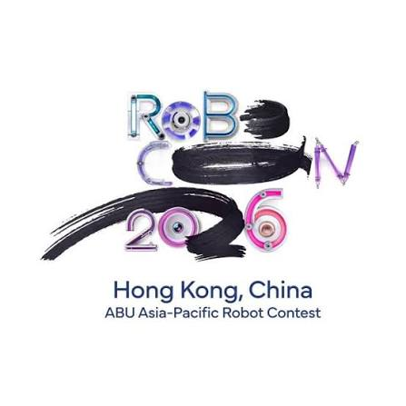
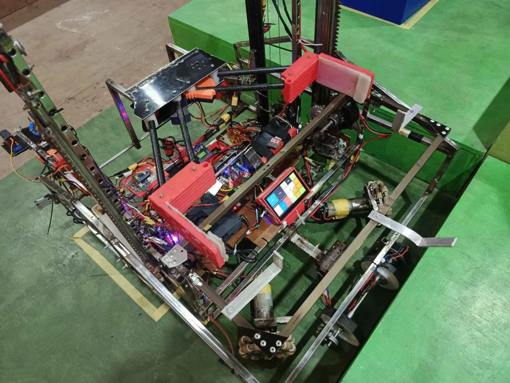
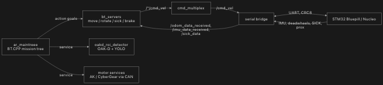
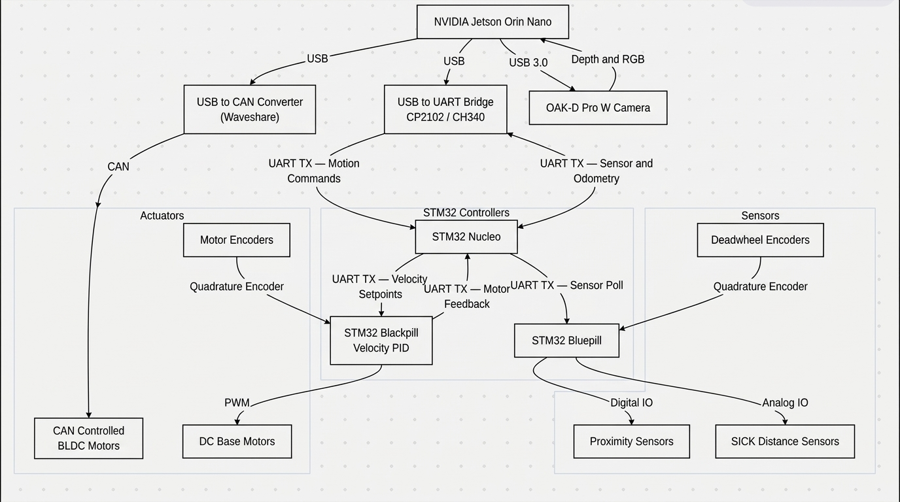
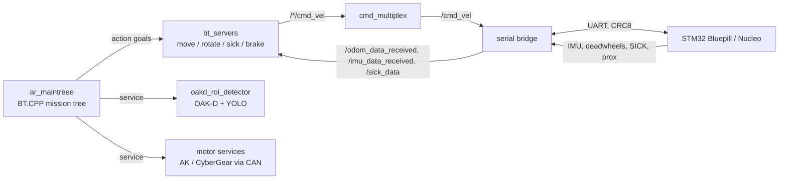

# ARROBO WS: ABU Robocon 2026 AR Robot

official contest site : https://app7.rthk.hk/special/aburobocon2026/

<p align="center">
  
</p>

[](https://docs.ros.org/en/humble/)
[](#)
[](#)
[](https://www.behaviortree.dev/)

ROS 2 workspace for the autonomous **AR (Autonomous Robot)** of the Nepal team at **ABU Robocon 2026, Hong Kong**. Built by the Robotics Club, IOE Pulchowk Campus.

<p align="center">
  
</p>
AR robot

The whole run is a single **BehaviorTree.CPP** mission tree. Small action servers do the closed-loop motion, a serial bridge talks to the STM32 boards, and an OAK-D pipeline handles vision.

---

## Mission Flow

```
Start → Martial Club → Mahua Forest → Arena
        │                │              │
        ├ spear assembly ├ scroll pick  └ place / approach
        ├ entrance scroll└ photo-sequence
        └ climb 3 photos
```

Progress is tracked with blackboard flags (`in_martial`, `spear_assembled`, `scroll_picked_from_entrance`, `climbed_three_photos`, `in_forest`, `in_arena`, ...) and guarded with `Precondition` nodes, so the tree can be re-ticked and resumed from any stage.

---

## Architecture

<p align="center">
  
</p>
<p align="center">
  
</p>



**Compute:** Jetson Orin Nano. **MCUs:** STM32 (Bluepill, Nucleo). **Sensing:** OAK-D, BNO IMU, deadwheel encoders, SICK distance sensors, proximity sensors. **Actuators:** AK-series and CyberGear motors over CAN, omni-drive base.

---

## Repository Layout

| Path | What it is | Submodule |
|------|------------|:---------:|
| [`ar_maintreee`](ar_maintreee) | Mission BT: nodes, XML trees, setpoints, params | |
| [`ar_interfaces`](ar_interfaces) | Custom action definition (`Movement.action`) | |
| [`bt_servers`](bt_servers) | PID action servers for base motion → [README](bt_servers/README.md) | yes (`2026_ROS2_SERVERS`) |
| [`2026_ROS2_SERIAL_BRIDGE`](2026_ROS2_SERIAL_BRIDGE) | Jetson ↔ STM32 bridge, odometry, cmd_vel mux → [README](2026_ROS2_SERIAL_BRIDGE/README.md) | yes |
| [`OAK60_ROS2`](OAK60_ROS2) | OAK-D ROI detector + AK-60 motor control → [README](OAK60_ROS2/README.md) | yes |

---

## Getting Started

### Prerequisites
- Ubuntu 22.04, **ROS 2 Humble**
- `behaviortree_cpp` (v4), `yaml-cpp`, `ament_index_cpp`
- Python: `pyserial`, `numpy`, `depthai`, `ultralytics`
- Packages referenced but not in this repo: `action_pkg`, `gripper_msgs`, `martial_tree`, `ar_interfaces_2026`, `ros2_bno_msg`

### Clone and build
```bash
mkdir -p ~/arrobo_ws && cd ~/arrobo_ws
git clone --recurse-submodules git@github.com:Pratik-45454/2026_ROS2_WORKSPACE.git src
cd ~/arrobo_ws
colcon build --symlink-install
source install/setup.bash
```

### Run
Start the lower layers first, then the tree:

```bash
# 1. Serial bridge + cmd_vel mux      → see 2026_ROS2_SERIAL_BRIDGE/README.md
# 2. Motion servers                   → see bt_servers/README.md
# 3. Vision + motor services          → see OAK60_ROS2/README.md

# 4. Mission tree
ros2 launch ar_maintreee tree_launch.py

# Debug (slows tick to 2 s for stepping through the tree)
ros2 run ar_maintreee bt --ros-args -p debug:=true
```

---

## Behavior Tree

Everything lives in [`ar_maintreee`](ar_maintreee).

```
ar_maintreee/
├── behavior_trees/main_trees/
│   ├── main_bt.xml              # MainTree: top-level sequence + stage guards
│   ├── martial_club/            # spear_assembly, entrance scroll pick, climb_three_photos
│   ├── mahua_forest/            # forest_tree, gripper_subtree
│   └── arena/                   # arena, arena_run, out_tree
├── src/ar_maintree/bt_nodes/
│   ├── actions/                 # robotBase (move, rotate, climb, roll, align...), scrollGripper
│   ├── conditions/              # prox, path clear, fallen scroll, goal / place checks
│   ├── decision_nodes/          # path planner, odom / SICK / arena decisions
│   ├── camera_nodes/            # ROI detections, hidden scroll finder
│   └── tree_flow_nodes/         # init, start/wait, zone config, setpoint loader, reset
├── include/robotlib/            # actuator, sensor, controller, filter drivers
├── config/master_params.yaml    # PID gains and limits for the servers
└── yaml_files/setpoints.yaml    # red / blue odom setpoints per task
```

**Notes**
- Team colour (`red` / `blue`) is read at init and used by `SetpointLoader` to pick the matching setpoints.
- Motion is done two ways: **odometry** (deadwheels + IMU) and **SICK** (distance to walls). Trees pick whichever fits the zone.
- `bt_trace.btlog` and the `tmp*.xml` / `experiment.xml` files are scratch trees for testing subtrees. Swap the registered file in `bt.cpp` to test one.

---

## Configuration

| File | Purpose |
|------|---------|
| `ar_maintreee/config/master_params.yaml` | PID gains, tolerances, velocity limits, roll angles |
| `ar_maintreee/yaml_files/setpoints.yaml` | `odom → {red, blue, common} → {martial, arena}` target points (mm) |
| `behavior_trees/main_trees/*.xml` | Mission logic |

Load params when launching servers:
```bash
ros2 run bt_servers move_server --ros-args --params-file src/ar_maintreee/config/master_params.yaml
```

---

## Gallery

<p align="center">
  
  
  
</p>

---

## Team

Robotics Club, IOE Pulchowk Campus, Tribhuvan University.
**Pratik Gyawali**

## License

See [`ar_maintreee/LICENSE`](ar_maintreee/LICENSE).